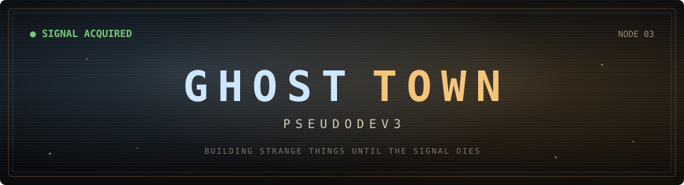

<div align="center">
  
</div>

<p align="center">
  &nbsp;&nbsp;<code>BUILDER OF STRANGE THINGS</code>
</p>

<p align="center">
  <a href="https://ghosttdev.ddns.net/">enter ghost town</a>
  &nbsp;·&nbsp;
  <a href="https://ponsfamily.com/">launch something</a>
  &nbsp;·&nbsp;
  <a href="https://github.com/pseudodev3?tab=repositories">inspect the artifacts</a>
</p>

## `> whoami`

I'm **ghostt** — just a guy turning odd ideas into working software.

I like interfaces that feel discovered rather than generated: old operating systems, forgotten corners of the web, pixel worlds, strange economies, and products with enough personality to haunt you a little.

```text
current mood : focused
location     : the void
mission      : reach superhero status by 2030
stack        : TypeScript · JavaScript · Python · Rust · Solidity · persistence
```

## `> active_transmissions`

| Signal | What escaped the lab | Status |
|:--|:--|:--:|
| [**Ghost Town**](https://ghosttdev.ddns.net/) | My living corner of the internet: CRT windows, ambient noise, particles, projects and a ghost in the machine. | `ONLINE` |
| [**Hakoware**](https://github.com/pseudodev3/hakoware) | Social bankruptcy, except reputation is aura and the interface refuses to look like a bank. | `EXPERIMENT` |
| [**PixelBlog**](https://github.com/pseudodev3/pixel-blog) | An embeddable pixel-art blog with Shadow DOM isolation and CRT attitude. | `OPEN SOURCE` |

<details>
<summary><strong>CLASSIFIED // currently building</strong></summary>
<br />

- a private network for assembling a team of superheroes
- stranger onchain machinery
- small internet objects that probably did not need to exist—but now do

</details>

## `> operating_principles`

```text
[01] personality is a feature
[02] ship the weird prototype
[03] make it work for real
[04] polish until it stops feeling accidental
[05] persistence beats motivation
```

---

<p align="center">
  <sub>signal remains active · visitors welcome · ghosts expected</sub>
</p>
